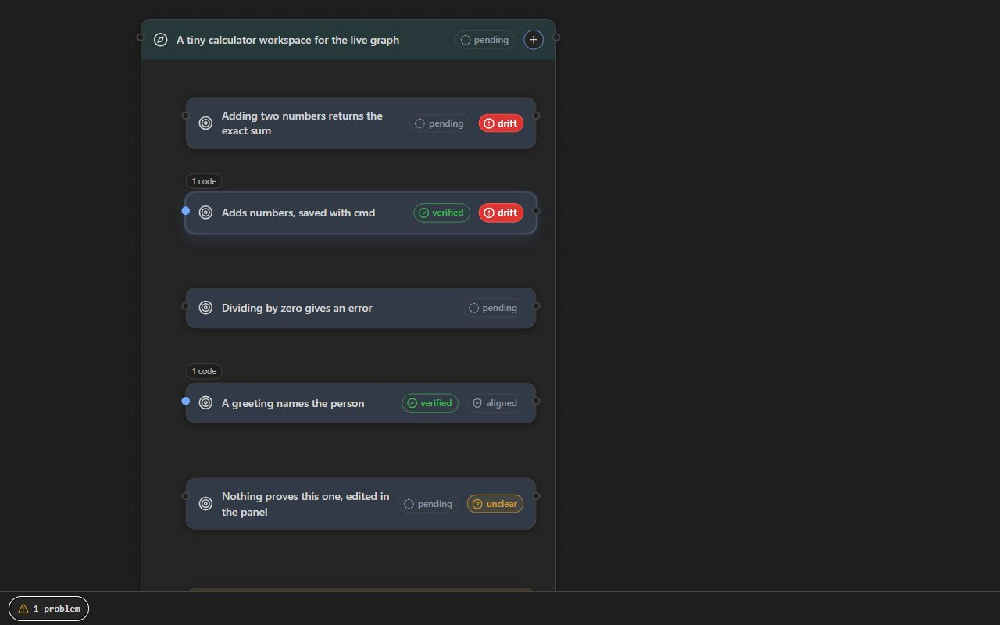

# Frames from 2026-11-27, day 2

Every frame was taken by a script on committed code, on the small calculator example. Each has a verdict: what works, and what is not there yet.

## Lane 7: direct editing

| | |
|---|---|
|  |  |
|  |  |

- **7a, rename in place.** Works: a double-click on a title opens a field right on the node with the text selected. Enter saves, Esc cancels. The node keeps its size and its marks. This frame is a first double-click on a node that was not selected, the case the verifier found broken and a second agent fixed.
- **7b, the right-click menu.** Works: on a concept it offers "Add intent here", "Rename" and "Edit details", and the plus in the header does the first of these. Not yet: the right-click also opens the side panel, so the view shifts under the open menu and the menu ends up over another node. Lane 8 takes that.
- **7c, the menu in read only.** Works: the edit entries are disabled and say why. Seen by the verifier, not looked at again after the fix.
- **7d, the plus in the concept header.** Works: it replaces the floating button that could be cut off at the top edge.
