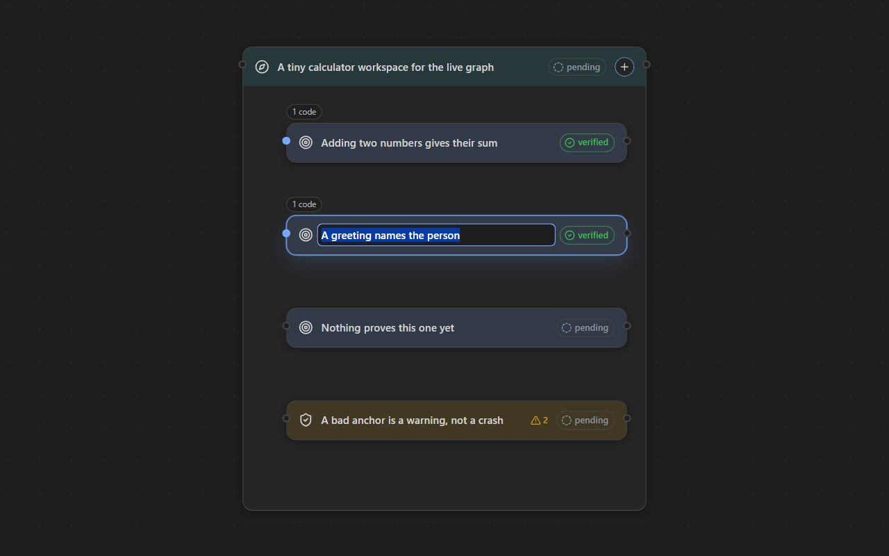
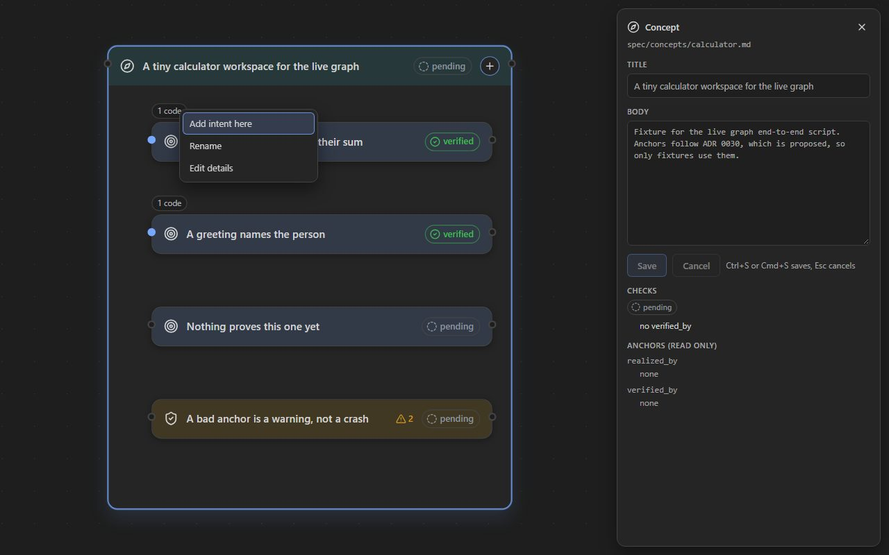
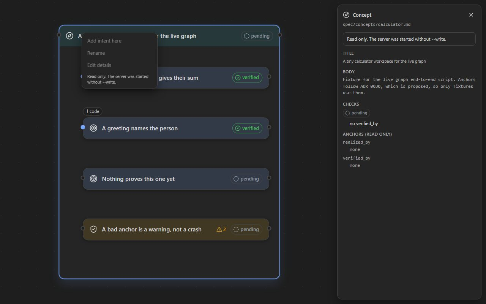
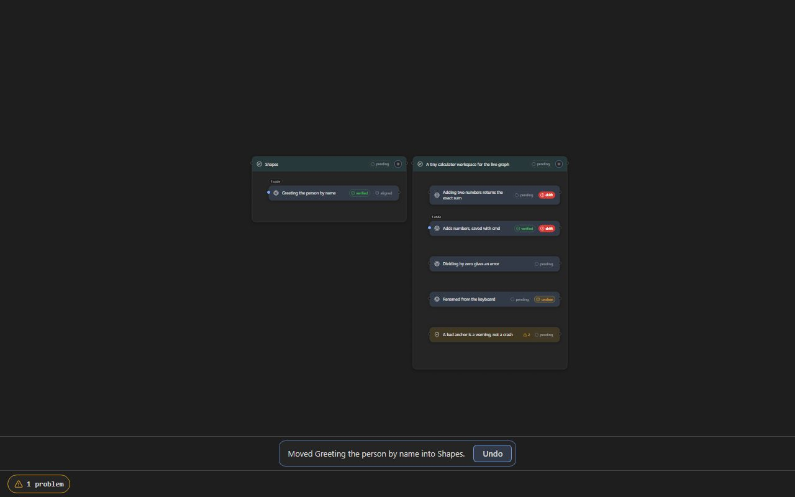
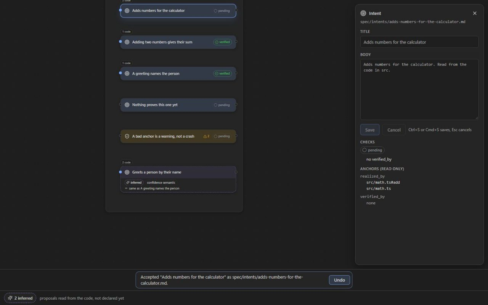

# Frames from 2026-11-27, day 2

Every frame was taken by a script on committed code, on the small calculator example. Each has a verdict: what works, and what is not there yet.

## Lane 7: direct editing

| | |
|---|---|
|  |  |
|  |  |

- **7a, rename in place.** Works: a double-click on a title opens a field right on the node with the text selected. Enter saves, Esc cancels. The node keeps its size and its marks. This frame is a first double-click on a node that was not selected, the case the verifier found broken and a second agent fixed.
- **7b, the right-click menu.** Works: on a concept it offers "Add intent here", "Rename" and "Edit details", and the plus in the header does the first of these. Retaken after lane 8, where a right-click stopped opening the side panel, so the view no longer shifts under the menu.
- **7c, the menu in read only.** Works: the edit entries are disabled and say why. Seen by the verifier, not looked at again after the fix.
- **7d, the plus in the concept header.** Works: it replaces the floating button that could be cut off at the top edge.

## Lane 8: editing by wire

| | |
|---|---|
|  |  |
|  |  |

- **8a, dragging a wire.** Works: a wire is pulled from a constraint's pin. The nodes that can take it are outlined in green, the rest are dimmed.
- **8b, connected.** Works: the constraint now hangs under the intent it was dropped on, and a notice says what happened, with an Undo button. Taken before the notices moved into their own strip, see `8d` for where they sit now.
- **8c, moving a node.** Works: an intent is dragged over another concept, and that box lights up because it would take it.
- **8d, moved.** Works: the intent sits in its new concept. The notice is in a strip under the canvas and covers no node.
- **8e, a refused drop** (`8e-refused-drop.jpg`). Works: "An intent can only hang under a concept, not a constraint. Nothing was changed."

Not yet, for both lanes: these frames are zoomed out, so the text is small. A code node's title was never tested. Nobody has tried any of it with a real mouse in a real browser window.

## Lane 10: inferred intents on the graph

Frames 10a to 10f were taken by the lane's end-to-end script on committed code, on the calculator example with a canned report. Frames 10g and 10h are this repo with its real report of 66 proposals, served from a temp copy. That report lives on the dev machine and is not in git.

| | |
|---|---|
|  |  |
|  |  |
|  |  |
|  |  |

- **10a, inferred beside declared.** Works: a proposal has a dashed outline, the word "inferred" and a confidence word. A planned one is fainter and says "planned". One that restates a declared intent says "same as" and its title. The strip under the canvas counts them.
- **10b, the panel.** Works: what the code is for, the folder it was read from, the evidence, and three buttons with their keys spelled out.
- **10c, accepted.** Works: Enter wrote a real intent file, the node turned solid, and the notice has Undo.
- **10f, anchors that point at nothing.** Works: the file is still written, the notice says how many anchors point at code that is not there, and the node carries the warning mark. Found by the verifier and fixed by a second agent.
- **10e, the count brings a proposal into view.** Works: a click on the count selects the next proposal and moves the view to it, clear of the panel. Found by the verifier and fixed by a second agent.
- **10d, read only.** Works: proposals show, the buttons are off and the panel says why.
- **10g, this repo, first view.** Not yet: 66 proposals swamp the 12 declared intents. The view no longer fits the graph, and the wire from the lower constraint runs through two proposal boxes.
- **10h, this repo after one click on the count.** Works, with small text: the proposal is selected and in view, and its panel names the declared intent it restates.

Not yet for lane 10: frame 10g. A node shows no key hint until it is selected. Nobody has tried it with a real mouse in a real browser window.
