# Frames from 2026-11-27, night 1

Every frame was taken by a script on committed code. Each has a verdict: what works, and what is not there yet. The files `1a` to `1e` and `3a` to `3g` show the state before lanes 4 to 6, so they can be laid beside the later ones. "Example" means the small calculator workspace in `tests/fixtures/live-workspace`.

## This repo, first view (lanes 1 and 4)

| Before | After |
|---|---|
| 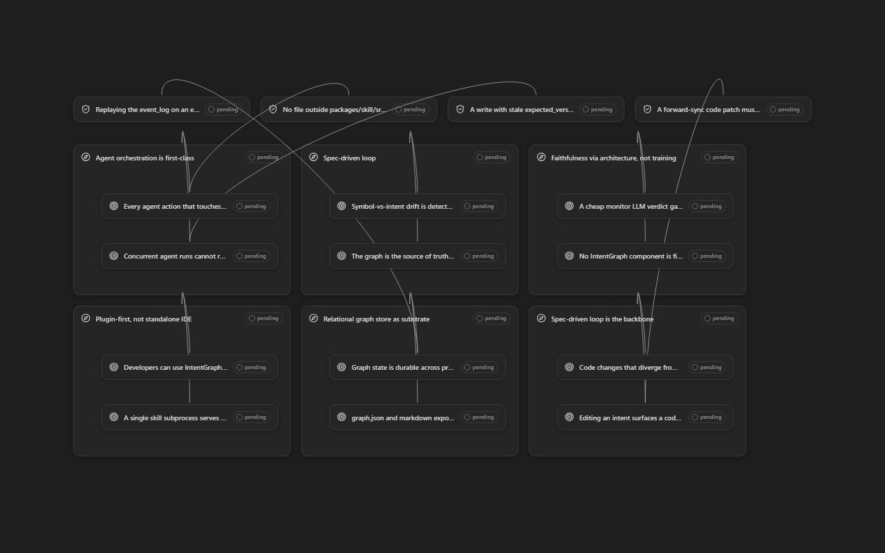 | 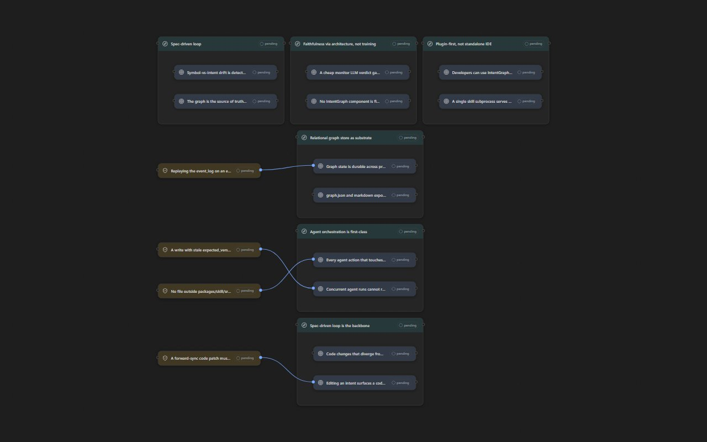 |

- **1a, before.** Works: the spec is the first thing on screen, and every node says pending, which is true. Not yet: wires loop through boxes and titles.
- **4a, after.** Works: it reads left to right, pins sit on both sides, four smooth wires, nothing is drawn over a title. Not yet: two wires cross each other, and there are only four wires because no spec node of this repo is bound to code yet.

## The example, with marks (lanes 1, 4 and 5)

| Before | After |
|---|---|
| 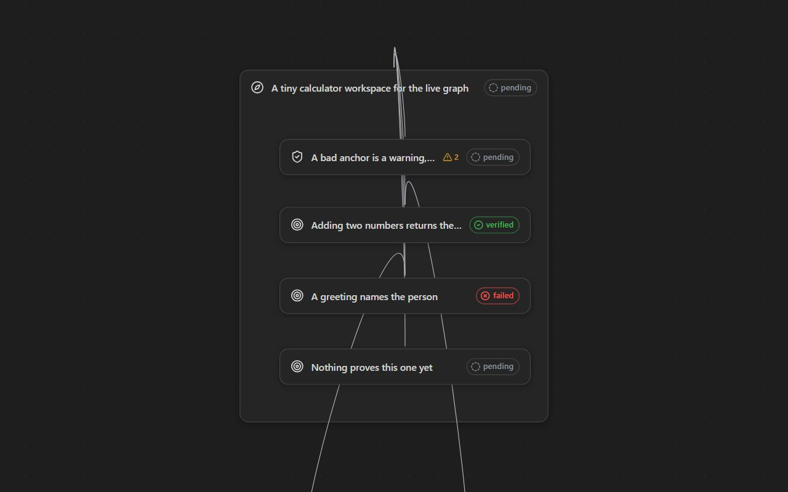 | 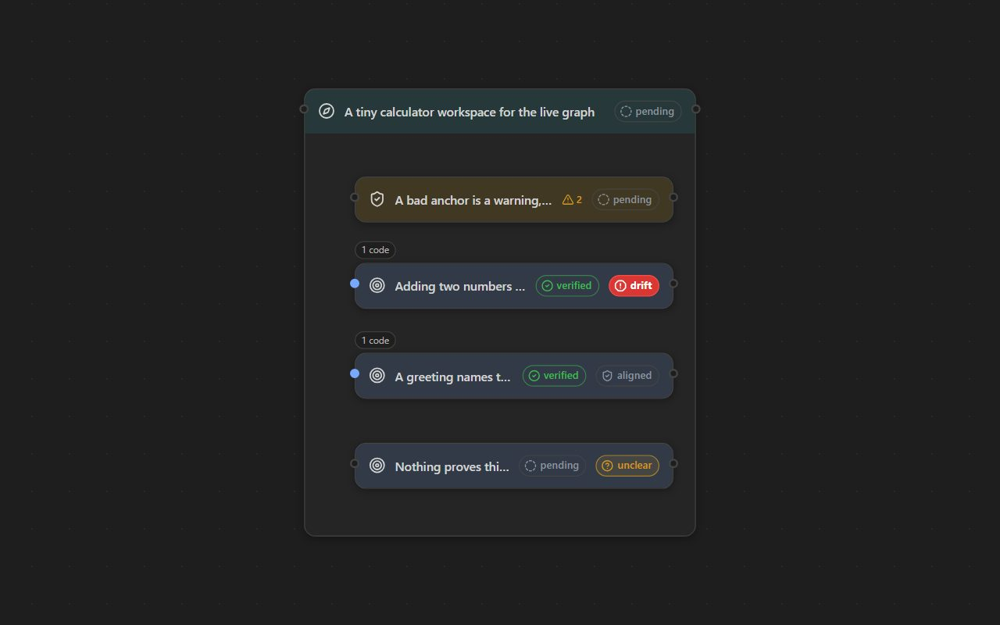 |

- **1e, before.** Works: a red failed mark 1.5 seconds after the test was broken. Not yet: loose lines above and below the box.
- **5a, after.** Works: header strips by kind, pins, a count for code behind a pin, and a drift mark beside the test mark. Drift is red and filled, unclear is amber, aligned is grey, each with an icon and a word. Not yet: titles were cut short here. Lane 6 fixed that, see `6h`.

## Editing a title (lanes 3 and 6)

| Before | After |
|---|---|
| 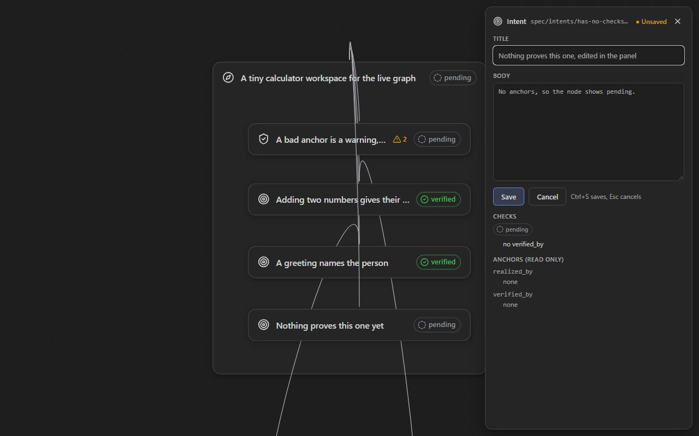 | 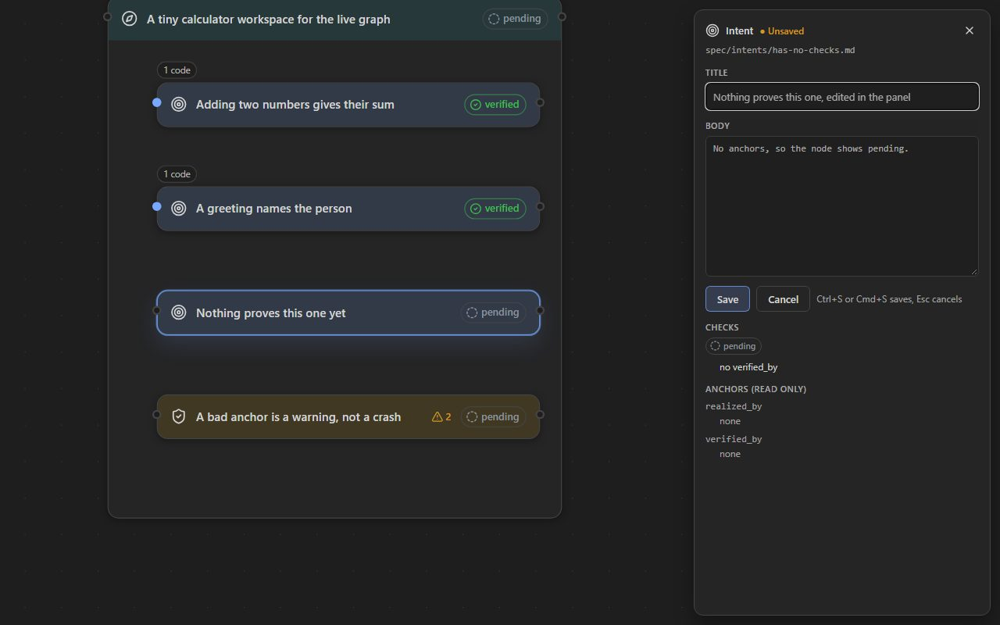 |

- **3b, before.** Works: the panel, an orange Unsaved mark, Save and Cancel. Not yet: the panel covers the edge of the box, the selected node is not marked, the path is cut.
- **6b, after.** Works: the selected node is outlined and clear of the panel, the path is whole, titles are whole. Not yet: the view moves the box up against the top edge.

## A new intent (lanes 3 and 6)

| Before | After |
|---|---|
| 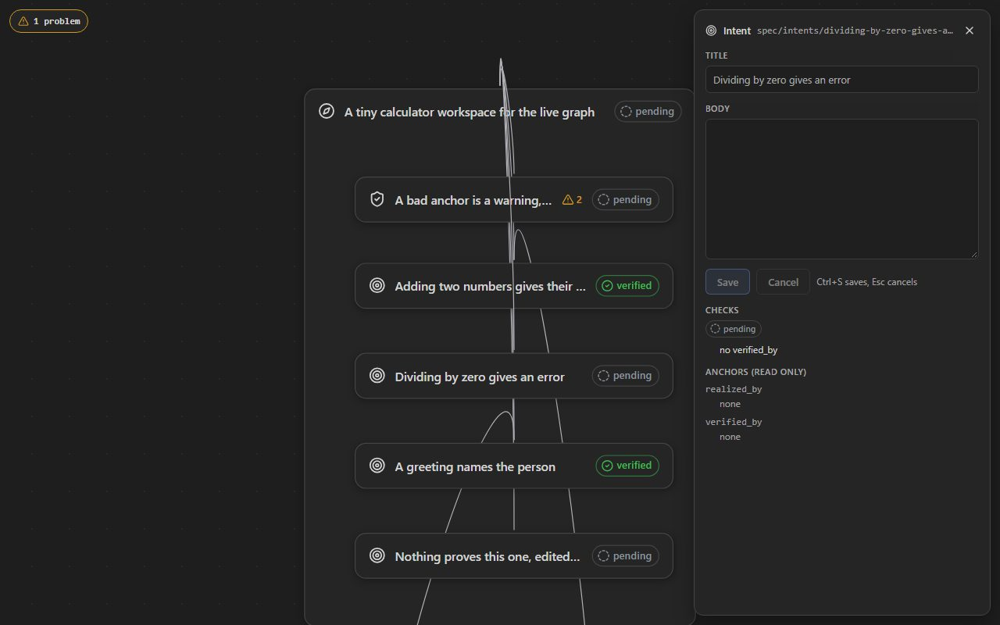 | 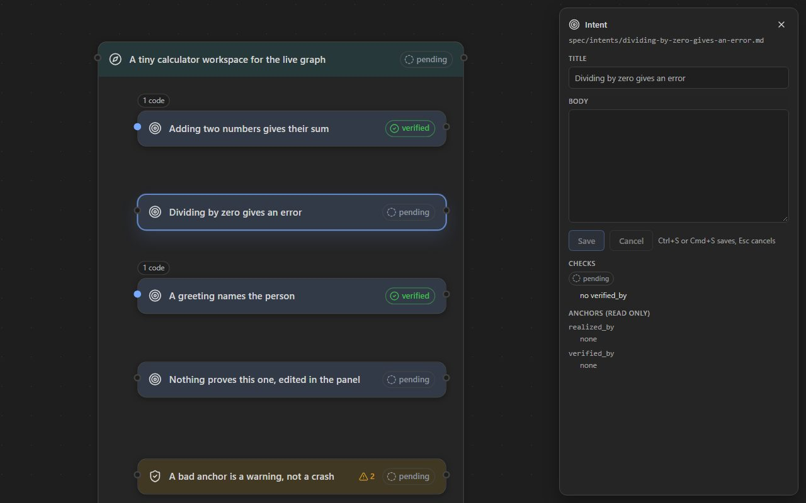 |

- **3e, before.** Works: the new node lands inside its concept. Not yet: "1 problem" appears, because the new file has no target kinds.
- **6e, after.** Works: no problem, the new node is selected. The form now asks for the kinds, see `6d`. Not yet: the form lists the nine node kinds from the code schema, while this repo's intents use `module` and `api`. That is on the Board for the owner.

## Read only (lanes 3 and 6)

| Before | After |
|---|---|
| 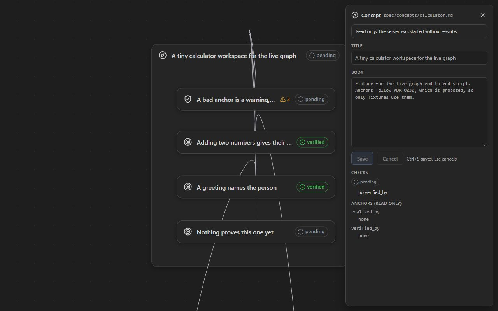 | 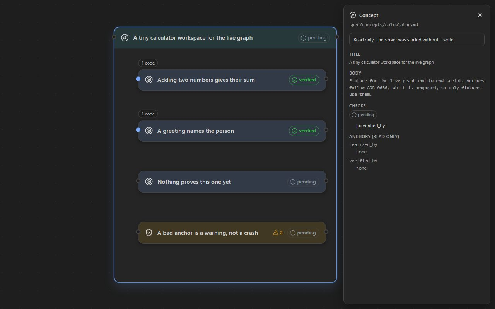 |

- **3g, before.** Not yet: the notice and the fields look like inputs.
- **6g, after.** Works: title and body are plain text, and there is no Save button.

## A broken spec file (lanes 1 and 6)

| Before | After |
|---|---|
| 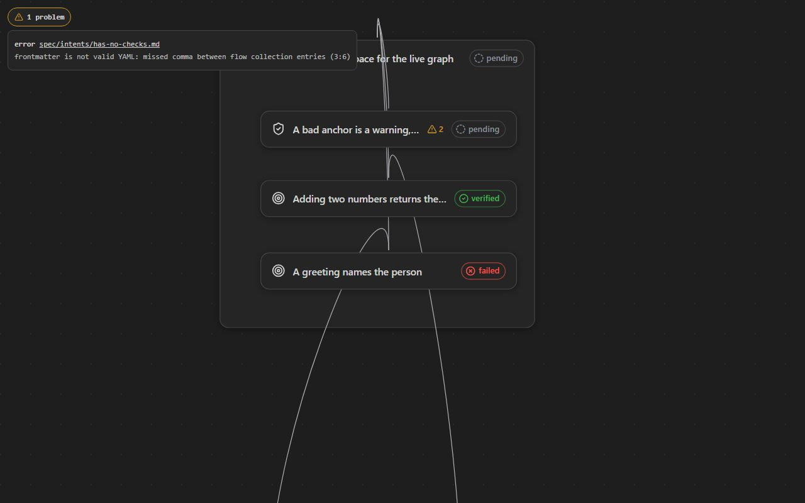 | 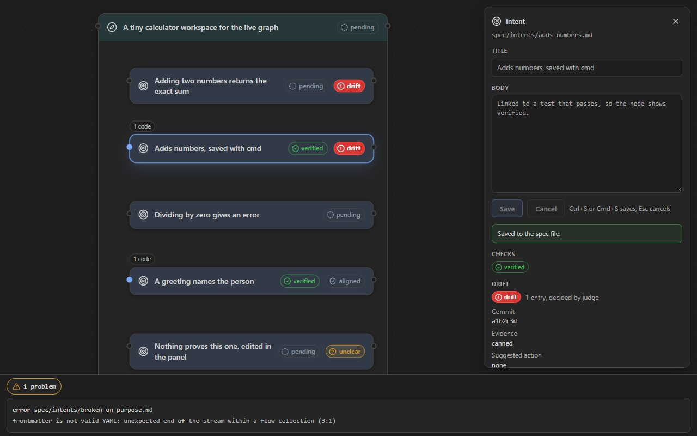 |

- **1d, before.** Works: the list names the file and the parser's message. Not yet: the open list covers a title.
- **6i, after.** Works: the list sits in a strip under the canvas and covers nothing.

## Singles

| | |
|---|---|
| 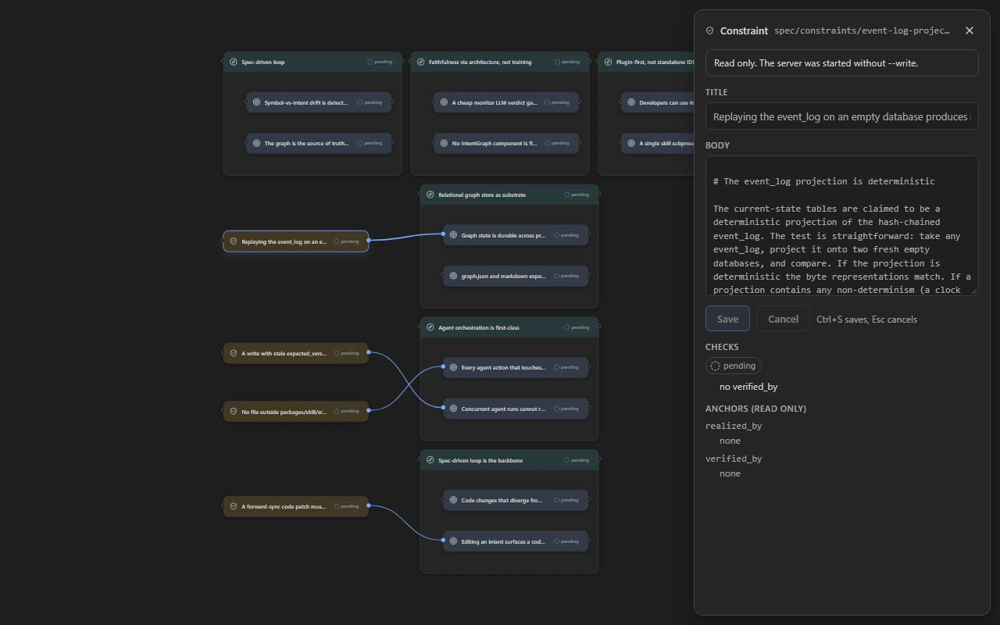 | 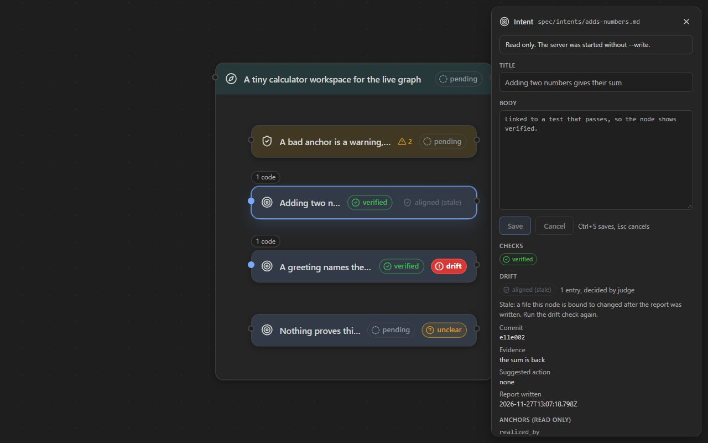 |
| 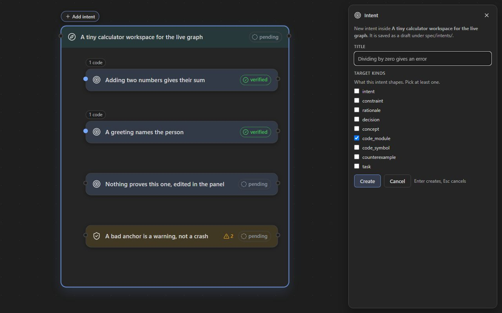 | 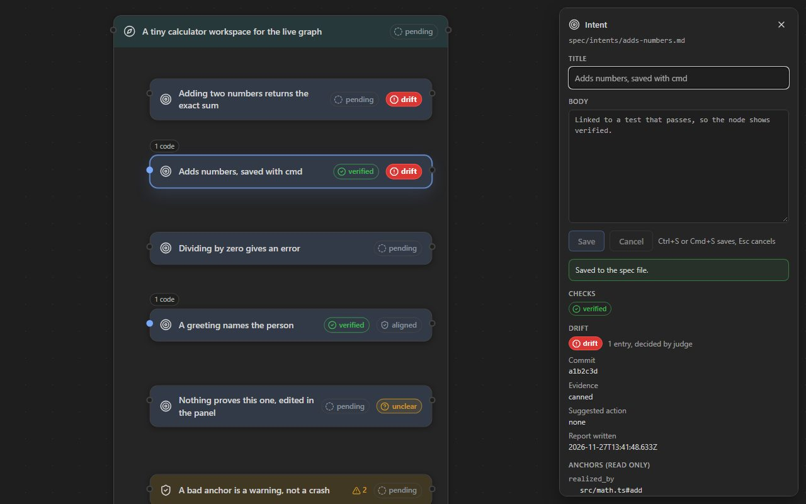 |

- **4e.** Works: only the selected constraint's wire is lit. Not yet: this was taken before lane 6, so the panel still covers the right edge.
- **5c.** Works: a stale verdict is dimmed and dashed, reads "aligned (stale)", and the panel says why and shows the commit and the evidence.
- **6d.** Works: the form asks for target kinds, with one preselected. Not yet: nine raw kind names is more than a person needs.
- **6h.** Works: a 40 character title wraps onto two lines beside two marks.

## Also in this folder

`1b`, `1c`, `3a`, `3c`, `3d`, `3f`, `4b`, `4c`, `4d`, `5b`, `6a`, `6c` and `6f` show the same views in other states. The verifier of each lane looked at them. Its verdicts are in the [Devlog](../../Devlog.md).
