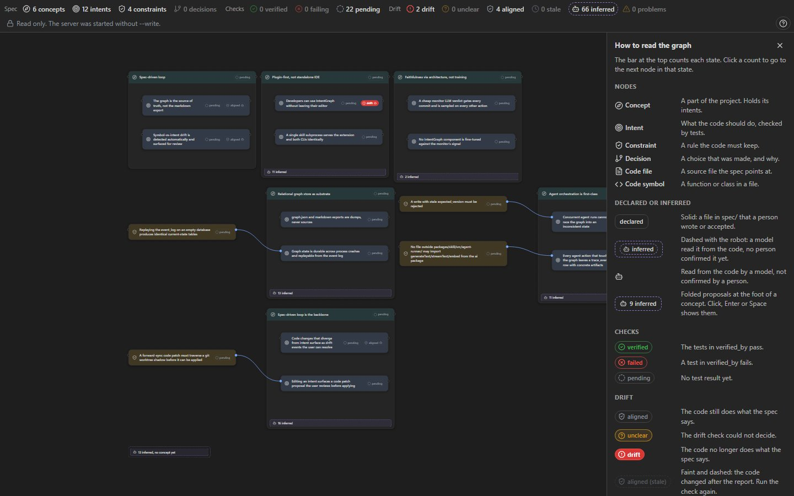
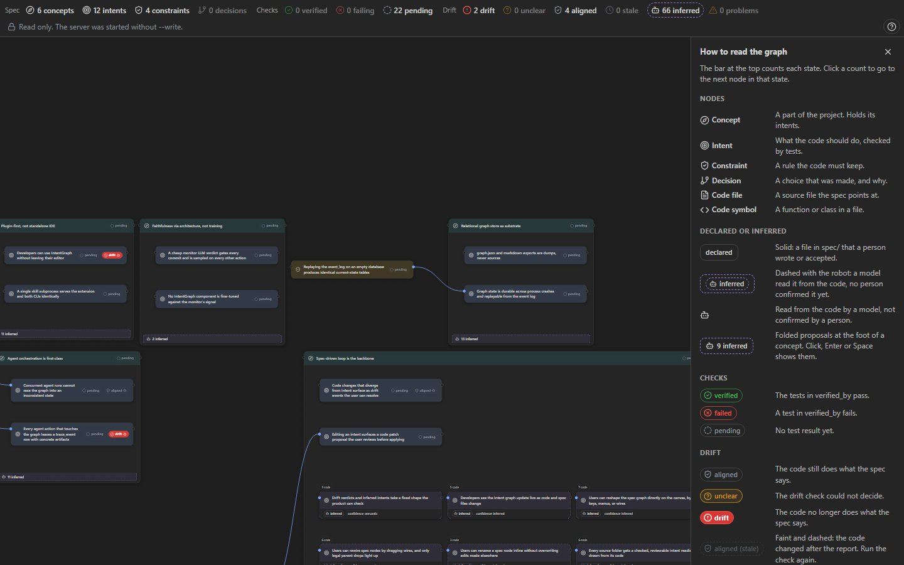
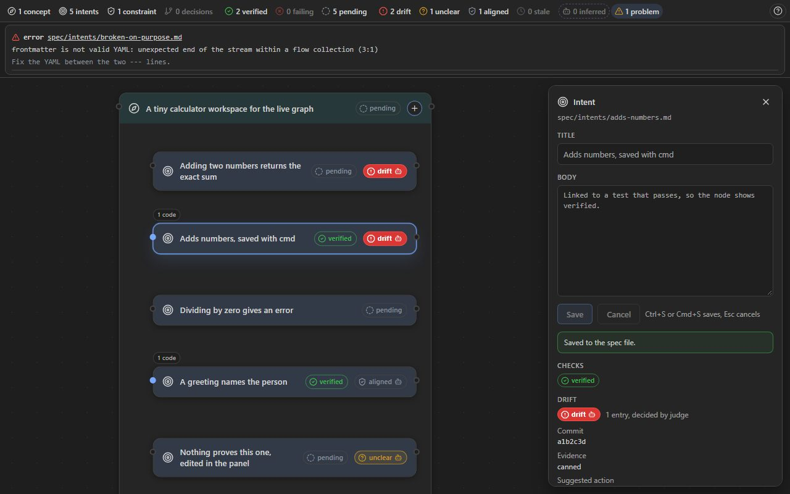
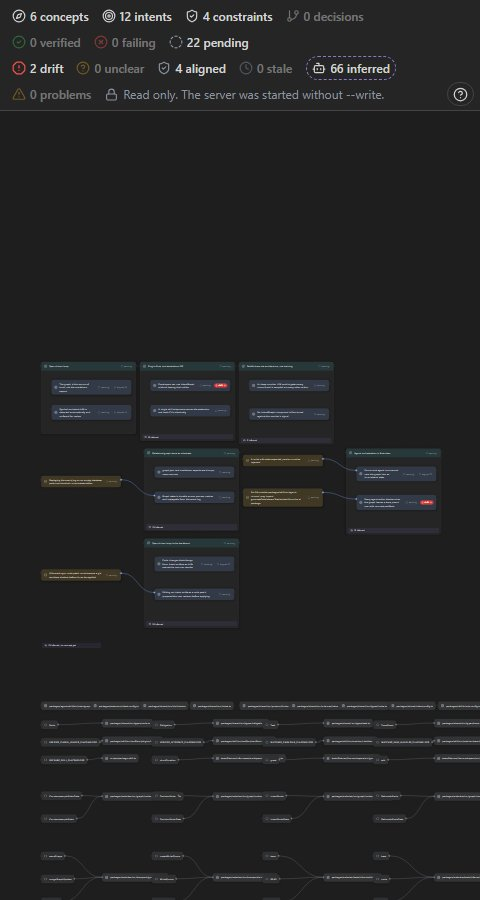
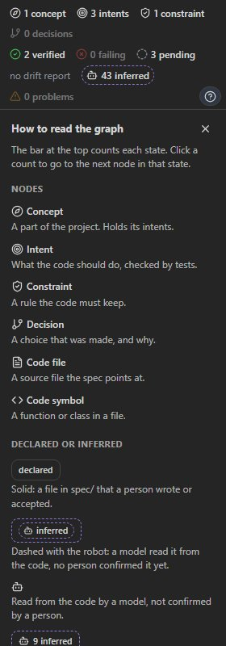

# Frames from 2026-11-28

Every frame was taken by a script on committed code. Each has a verdict: what works, and what is not there yet.

## Lane 16: the graph in an editor panel

Taken by `node tools/e2e-extension.mjs` on the small calculator example, in a separate VS Code window with its own profile.

| | |
|---|---|
|  |  |

- **16a, the graph beside the code.** Works: the graph of the open folder shows in a panel of VS Code, with the state bar, and the code sits beside it. A message from the page opened `src/math.ts` at line 3. Not yet: the legend of a first visit covers most of the panel. The page is dark while the editor is light. A click on a node does not open code yet, the page's half of that comes with a page lane. Nothing on the page names the folder or says it is live.
- **16b, a window 900 px wide.** The panel is about 280 px wide. The bar works: it wraps and every count can be read. Not yet: the read-only line is cut short, and the legend's text breaks to one word a line. Lane 12 fixed the legend afterwards, see 12e.

The toast about installed extensions being off is expected: the separate window starts with none of the owner's extensions.

Not yet for lane 16: while the page has the focus, the editor's own shortcuts do not fire, and a click on the code gives them back. Nobody has used it with a real mouse for a real task.

## Lane 12: a first view that fits

Taken by `node tools/e2e-fold.mjs --frames` on the committed lane head. 12a, 12b and 12d are this repo with its real inference report (66 proposals) and a canned drift report. 12c and 12e are the small example.

| | |
|---|---|
|  |  |
|  |  |
|  | |

- **12a, this repo, a first visit.** Works: the whole declared graph is in one view. Six concepts, their 12 intents, 4 constraints with their wires, and no wire through a box. Each concept has one dashed row at its foot such as "16 inferred", and the rows add up to the 66 in the bar. Not yet: the legend of a first visit lies over the right edge of the graph until it is closed.
- **12b, one concept unfolded.** Works: its proposals show inside it, below the declared intents, dashed, and its header stayed where it was. Not yet: the whole graph is laid out again, so the other concepts move and part of the graph leaves the view. F fits again.
- **12c, the problems list.** Works: one count in the bar, and a click opens the list under the bar. The row says the file, what is wrong and what to do next.
- **12d, this repo at 480 px.** Works: the bar wraps, no legend opens by itself, and every declared node is in view. Not yet: at this size the text cannot be read, and the code files below run off the right edge.
- **12e, the legend at 280 px.** Works: opened from "?", it takes the full width, each label has its words under it, and it scrolls inside itself.

Not yet for lane 12: an unfold takes about a second on this repo. Nobody has tried it with a real mouse inside the editor panel.
