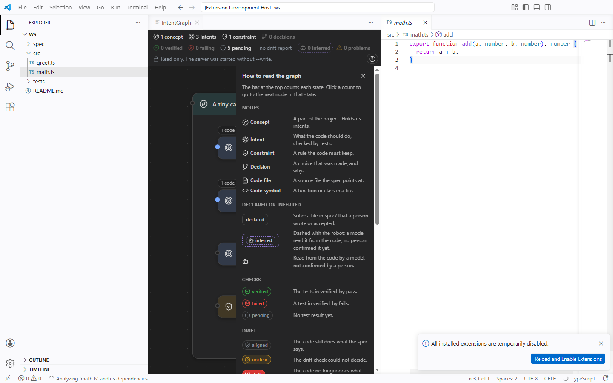
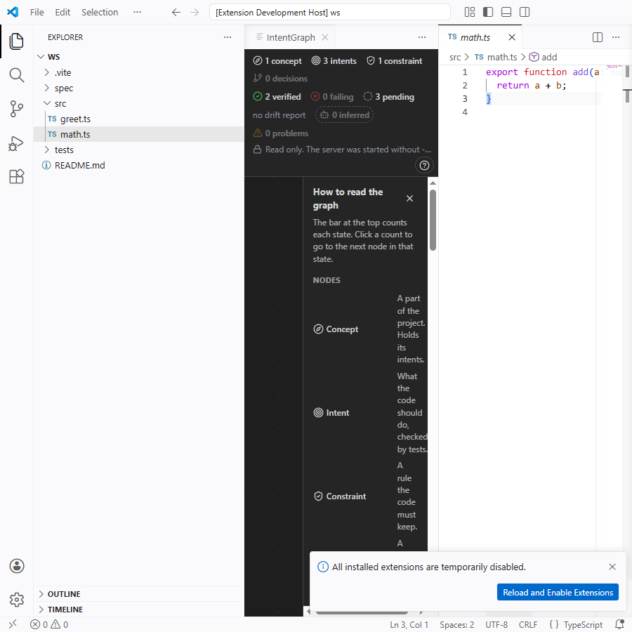

# Frames from 2026-11-28

Every frame was taken by a script on committed code. Each has a verdict: what works, and what is not there yet.

## Lane 16: the graph in an editor panel

Taken by `node tools/e2e-extension.mjs` on the small calculator example, in a separate VS Code window with its own profile.

| | |
|---|---|
|  |  |

- **16a, the graph beside the code.** Works: the graph of the open folder shows in a panel of VS Code, with the state bar, and the code sits beside it. A message from the page opened `src/math.ts` at line 3. Not yet: the legend of a first visit covers most of the panel. The page is dark while the editor is light. A click on a node does not open code yet, the page's half of that comes with a page lane. Nothing on the page names the folder or says it is live.
- **16b, a window 900 px wide.** The panel is about 280 px wide. The bar works: it wraps and every count can be read. Not yet: the read-only line is cut short, and the legend's text breaks to one word a line. The legend is being fixed in lane 12's fix round.

The toast about installed extensions being off is expected: the separate window starts with none of the owner's extensions.

Not yet for lane 16: while the page has the focus, the editor's own shortcuts do not fire, and a click on the code gives them back. Nobody has used it with a real mouse for a real task.
